[English](README.md) · [Deutsch](README.de.md) · **Italiano**

<p align="center">
  <picture>
    <source media="(prefers-color-scheme: dark)" srcset="brand/readme/logo-readme-dark.png">
    
  </picture>
</p>

<p align="center">
  <strong>Galleria fotografica e video self-hosted per fotografi e studi.</strong><br>
  Un'alternativa self-hostable a Picdrop, Pixieset e Pic-Time — i tuoi dati restano con te.
</p>

<p align="center">
  <a href="https://github.com/markusthiel/lumio/releases"></a>
  <a href="#licenza"></a>
  <a href="#quick-start"></a>
  <a href="https://lumio-app.de"></a>
</p>

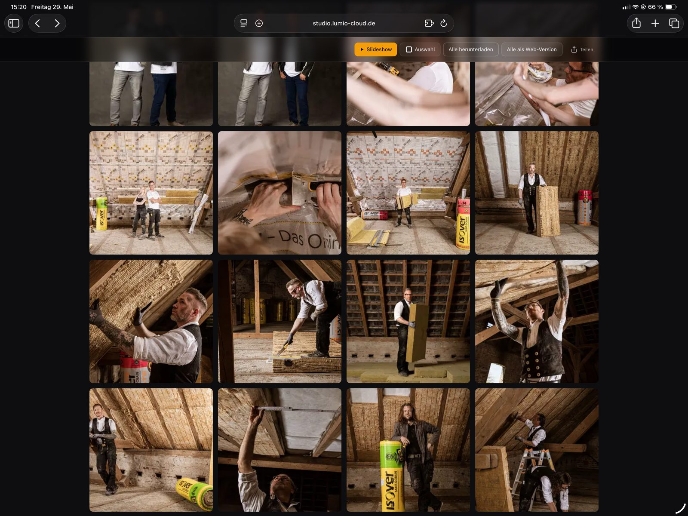

---

## Per chi è pensato Lumio?

Tre configurazioni tipiche — la Quick Start qui sotto copre la prima; tutto il resto è opzionale.

| Sei… | Setup | Doc |
|---|---|---|
| **Fotografo o studio** | Single mode, storage incluso, un dominio | [Quick Start](#quick-start) — 5 minuti |
| **Agenzia con più clienti fotografi** (self-hosted, per la tua attività) | Multi mode senza billing, tenant creati manualmente tramite super admin | [docs/MULTI_TENANT.md](docs/MULTI_TENANT.it.md) |

In **single mode** il tenant viene creato automaticamente al primo avvio — ti serve solo `create-admin` per il tuo primo utente. Nessun super admin, nessun Stripe.

> **Vuoi offrire Lumio come SaaS a terzi paganti?** Questo è *Competing Use* e non è liberamente consentito dalla licenza (è il modello di business dietro il nostro lumio-cloud.de). Una licenza commerciale è disponibile su richiesta — vedi [Licenza](#licenza). La modalità SaaS è documentata in [docs/SAAS_MODE.md](docs/SAAS_MODE.it.md).

---

## Funzionalità

- 🚀 **Veloce** — Caricamenti diretti su S3, gallerie virtualizzate, miniature libvips
- 📷 **Supporto RAW** — CR2, CR3, NEF, ARW, RAF, DNG, ORF, PEF, RW2, X3F via LibRaw
- 🎬 **Streaming video** — Bitrate adattivo HLS, anteprime scrubbing, poster frame
- 💬 **Proofing** — Like, color tag, valutazioni a stelle, commenti, annotazioni disegnate su foto **e video** (ancorate nel tempo), votazione di team
- 🎨 **Whitelabel** — Logo, colori, domini personalizzati per studio o galleria
- 🔐 **Sicuro** — URL firmati, password Argon2, audit log
- ☁️ **Archiviazione flessibile** — RustFS incluso, S3, R2, B2, Wasabi, Hetzner Object Storage
- 🐳 **Docker-first** — `docker compose up` e funziona

Lo studio — gestisci gallerie, collezioni smart, filtri per tag, proofing di team:

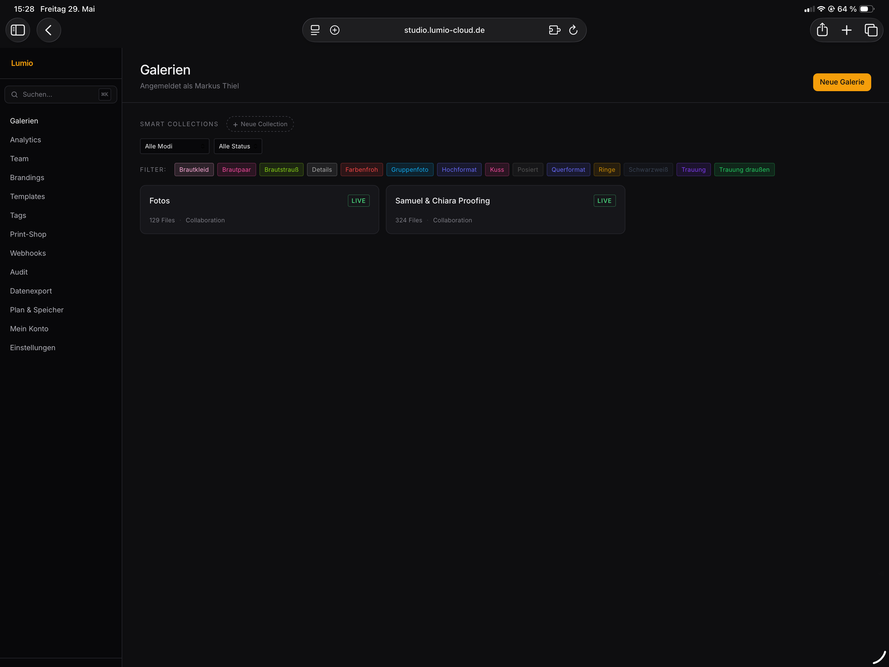

---

## Uno sguardo più da vicino

**Proofing e annotazioni** — I clienti mettono like alle immagini, assegnano color tag e disegnano annotazioni direttamente sulla foto, con commenti per ogni foto.

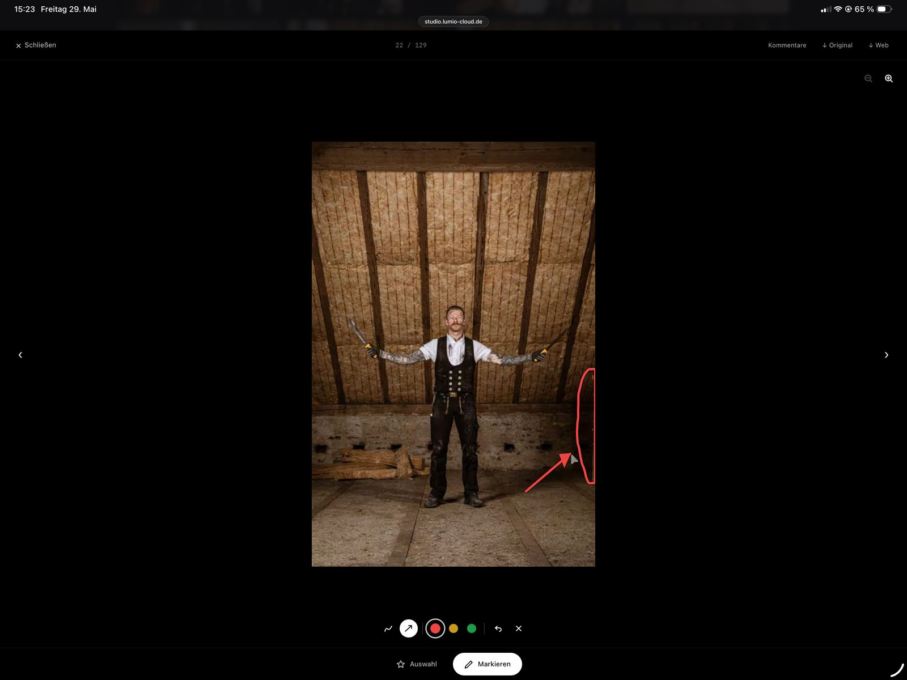

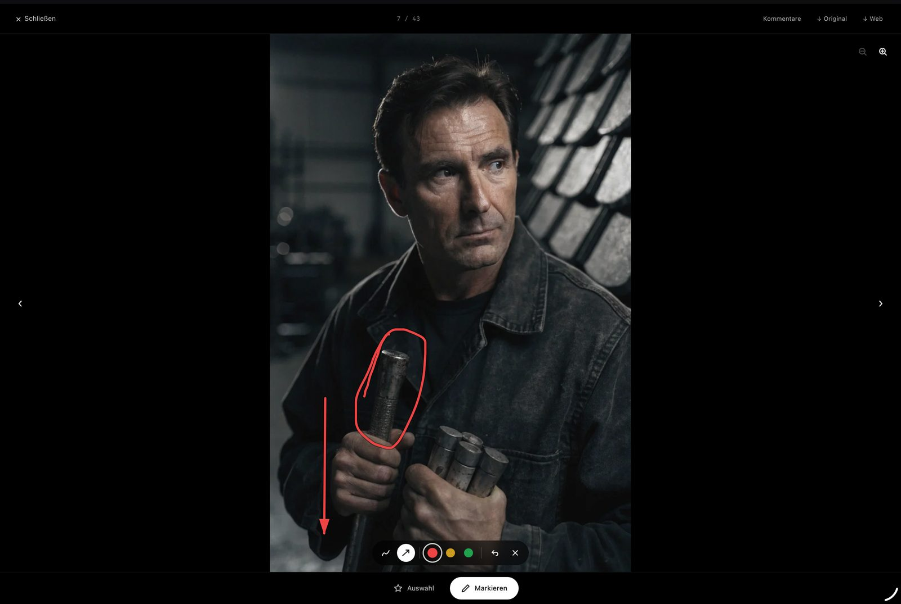

**Video proofing** — Anche i video vengono revisionati come una foto: i clienti scorrono il video tramite filmstrip, posizionano annotazioni in un punto preciso nel tempo e disegnano direttamente sul fermo immagine — con una nota opzionale per ogni annotazione.

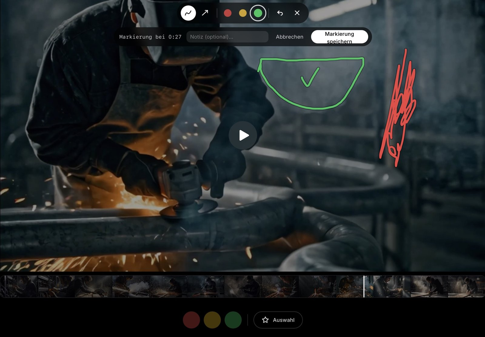

Scrubbing tramite filmstrip — trascinando lungo la barra viene mostrata un'anteprima del fotogramma corrispondente con il relativo timestamp:

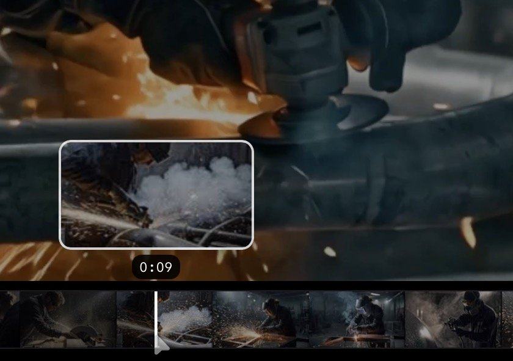

**Caricamento e formati** — Drag & drop con caricamenti paralleli, rilevamento dei duplicati e sezioni smart. JPEG, PNG, WebP, RAW, HEIC/HEIF, video e PDF — fino al limite di file configurabile.

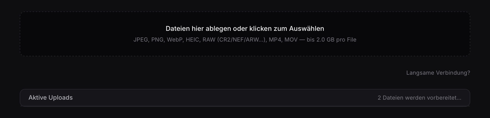

**Auto-tagging con IA** — Le immagini vengono taggate automaticamente (modello CLIP); i suggerimenti possono essere filtrati per soglia di confidenza e applicati. I clienti possono opzionalmente filtrare per tag.

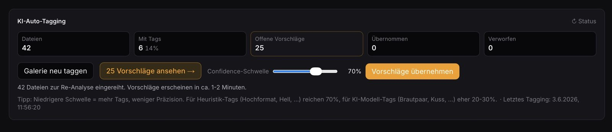

**Design della galleria** — Per ogni galleria: layout, disposizione delle immagini, transizioni della slideshow, immagine hero, logo dell'evento, colori. Whitelabel fin nel dettaglio.

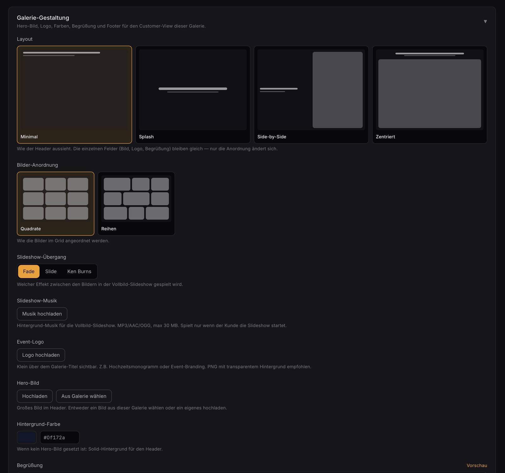

**Analytics** — Visualizzazioni, immagini più popolari, download e un funnel di engagement dalla visita all'ordine.

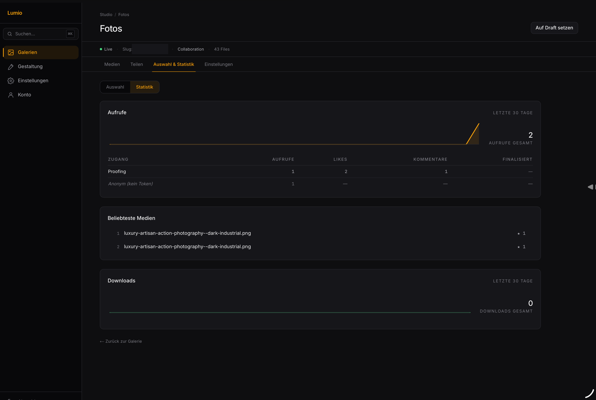

**Print shop** — Vendi stampe, tele e fotolibri direttamente dalla galleria. I tuoi provider, prodotti, spedizione, opzionalmente con pagamento Stripe.

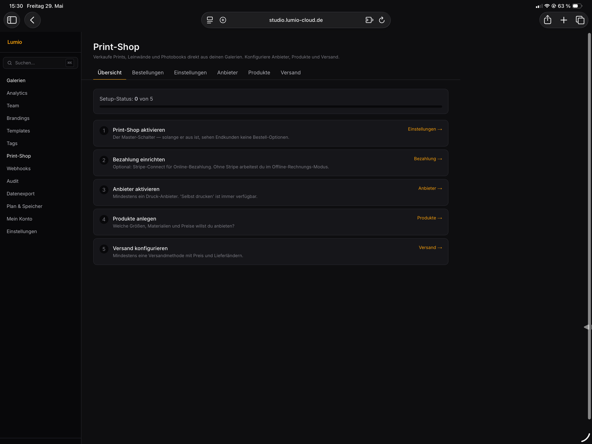

**Sicurezza e GDPR** — Accordo sul trattamento dei dati ai sensi dell'Art. 28 GDPR firmabile elettronicamente, link di condivisione con scadenza e password, audit log e autenticazione a due fattori.

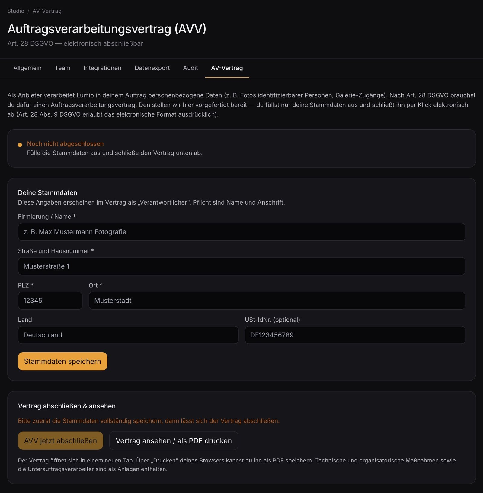

**Webhook e integrazioni** — Notifica strumenti esterni tramite HTTP POST sugli eventi della galleria. Ogni richiesta è firmata con il tuo webhook secret.

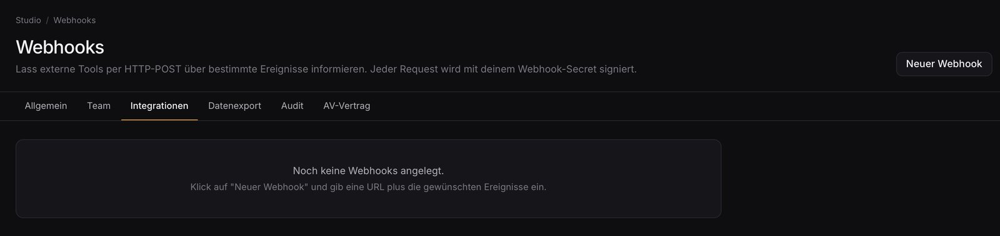

**Modalità chiara o scura** — Il backend dello studio in chiaro o scuro, con un proprio colore di accento e varianti del logo per entrambe le modalità. (Gli altri screenshot qui mostrano la modalità scura.)

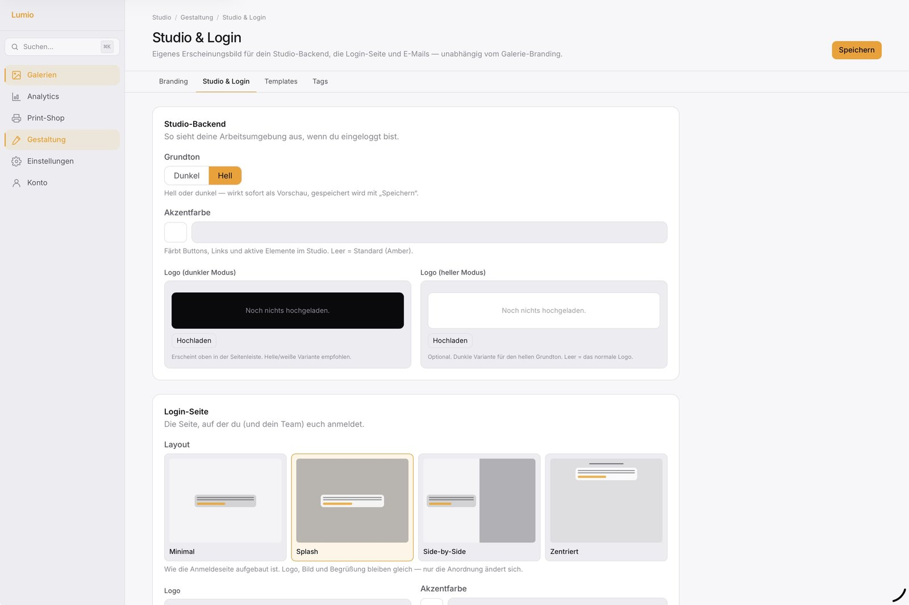

---

## Quick Start

**5 minuti da zero alla tua prima galleria.** Requisiti: Docker + Docker Compose v2 (amd64 o arm64). Dettagli: [docs/REQUIREMENTS.md](docs/REQUIREMENTS.it.md).

### 1. Clona il repository e imposta i secret

```bash
git clone https://github.com/markusthiel/lumio.git
cd lumio
cp .env.example .env

# Generate and insert secure passwords
sed -i "s|^POSTGRES_PASSWORD=.*|POSTGRES_PASSWORD=$(openssl rand -base64 24 | tr -d '/+=')|" .env
sed -i "s|^JWT_SECRET=.*|JWT_SECRET=$(openssl rand -base64 32 | tr -d '/+=')|" .env
sed -i "s|^SESSION_SECRET=.*|SESSION_SECRET=$(openssl rand -base64 32 | tr -d '/+=')|" .env
sed -i "s|^S3_ACCESS_KEY=.*|S3_ACCESS_KEY=$(openssl rand -hex 12)|" .env
sed -i "s|^S3_SECRET_KEY=.*|S3_SECRET_KEY=$(openssl rand -base64 32 | tr -d '/+=')|" .env
```

### 2. Avvia

```bash
docker compose up -d
```

Questo compila i container e avvia Postgres, Redis, lo storage S3 incluso (RustFS), API, frontend, worker e Caddy. Il primo avvio richiede 3–5 min (build + migrazione del DB).

Verifica lo stato:

```bash
docker compose ps
```

Tutti i servizi dovrebbero risultare `running` (healthy).

> **Nota sul firewall cloud:** apri le porte **80** (app) e **9000** (storage S3 —
> il browser carica e recupera le immagini direttamente dall'object storage).
> Senza la 9000, i caricamenti falliscono immediatamente.

### 3. Crea un utente admin

```bash
docker compose exec api npm run create-admin -- \
  --email=you@example.com \
  --password=atleast12chars \
  --name="Your Studio"
```

### 4. Accedi

Nel tuo browser:

→ **http://localhost** (login dello studio) — oppure, su un server remoto,
semplicemente **http://\<server-ip\>** (digita esplicitamente `http://`; alcuni
browser forzano `https://`, e per un IP nudo non esiste un certificato)

> **Nota:** Accedi sempre a Lumio tramite la **porta 80** (il proxy Caddy) — instrada
> `/api/*` verso l'API. Nessuna configurazione necessaria per l'accesso via IP; lascia `LUMIO_HOST`
> vuoto. In alternativa, crea un tunnel sulla porta 80 (non 3000):
> `ssh -L 8080:127.0.0.1:80 your-server` → poi apri `http://localhost:8080`.
> (Dalla v0.49.1 anche la porta 3000 del frontend inoltra le chiamate API come fallback,
> ma la porta 80 resta il punto di ingresso previsto.)

Dopo aver effettuato l'accesso trovi la creazione della galleria in alto a sinistra. Carica una foto, condividi il link della galleria — fatto.

---

## È in esecuzione. E adesso?

- **Aggiornare un'installazione esistente** → `git pull && docker compose up -d --build` —
  il `--build` è importante: i fix spesso si trovano dentro le immagini (Caddy, API, frontend),
  un semplice `up -d` continua a far girare quelle vecchie. Dettagli: [docs/SELFHOSTING.md](docs/SELFHOSTING.it.md#aggiornamenti)

- **Collega il tuo dominio** → [docs/SELFHOSTING.md](docs/SELFHOSTING.it.md) (setup di 15 minuti con HTTPS)
- **Le immagini spariscono al riavvio dei container?** → Lo storage incluso archivia i dati nel volume `rustfs_data` (installazioni precedenti alla v0.89: `minio_data`), che persiste. Assicurati solo di non eseguire accidentalmente `docker volume rm` su di esso.
- **Configura i backup** → [docs/BACKUP.md](docs/BACKUP.it.md)
- **Qualcosa non funziona?** → [docs/TROUBLESHOOTING.md](docs/TROUBLESHOOTING.it.md)

---

## Architettura

```
┌──────────┐    ┌──────────┐    ┌────────────────┐
│ Frontend │◄──►│   API    │◄──►│ Postgres/Redis │
│ Next.js  │    │ Fastify  │    │  + S3 Storage  │
└──────────┘    └────┬─────┘    └────────────────┘
                     │
                     ▼
                ┌─────────┐
                │ Worker  │  RAW decode, thumbnails,
                │ Python  │  video transcode, ZIP build
                │ Celery  │
                └─────────┘
```

- **`apps/frontend`** — Next.js 16 (App Router) + Tailwind
- **`apps/api`** — Fastify + Prisma (Postgres) + BullMQ (Redis)
- **`apps/worker`** — Python + Celery + rawpy/pyvips/ffmpeg
- **`packages/shared`** — Tipi TypeScript condivisi + schemi Zod
- **`infra/`** — Config Caddy, init Postgres

---

## Configurazioni avanzate

Tutto opzionale. La Quick Start sopra è sufficiente per un singolo studio.

| Scenario | Doc |
|---|---|
| Produzione dietro un dominio proprio con HTTPS | [docs/SELFHOSTING.md](docs/SELFHOSTING.it.md) |
| Più studi su un'unica istanza | [docs/MULTI_TENANT.md](docs/MULTI_TENANT.it.md) |
| Portfolio pubblico o una pagina per cliente | [docs/LANDING_PAGES.it.md](docs/LANDING_PAGES.it.md) |
| Cartelle per molte gallerie, script tramite API | [docs/FOLDERS.it.md](docs/FOLDERS.it.md) |
| Modalità SaaS con billing Stripe | [docs/SAAS_MODE.md](docs/SAAS_MODE.it.md) |
| Accelerazione GPU (NVENC + tag IA) | [docs/GPU.md](docs/GPU.it.md) |
| Auto-tagging IA (CLIP) | [docs/ML.md](docs/ML.it.md) |
| Sottodomini per tenant tramite certificato wildcard | [docs/WILDCARD.md](docs/WILDCARD.it.md) |
| Distribuire il carico su più server | [docs/SCALING.md](docs/SCALING.it.md) |
| S3 esterno invece dello storage incluso (R2, B2, Hetzner, Wasabi) | [docs/STORAGE.md](docs/STORAGE.it.md) |
| Backup, migrazioni, re-queue | [docs/OPERATIONS.md](docs/OPERATIONS.it.md) |
| Contribuire / sviluppo | [docs/DEVELOPMENT.md](docs/DEVELOPMENT.it.md) |

---

## Licenza

[Functional Source License 1.1 (FSL-1.1-ALv2)](LICENSE) — una licenza *source-available* (non open source OSI).

**Permesso a chiunque:**
- Privati, fotografi professionisti e studi: usare, self-hostare, modificare — anche commercialmente per la propria attività
- Agenzie: gestire Lumio nell'ambito di servizi per i propri clienti

**Non permesso:**
- Costruire un'offerta SaaS/cloud ospitata concorrente, che fornisce a terzi come prodotto funzionalità uguali o sostanzialmente simili a Lumio (*Competing Use*)

**A tempo limitato:** Ogni versione diventa automaticamente disponibile sotto [Apache License 2.0](http://www.apache.org/licenses/LICENSE-2.0) due anni dopo il suo rilascio — poi senza restrizioni.

Per un'offerta ospitata/concorrente, è disponibile una licenza commerciale su richiesta.

---

## Come contribuire

Pull request benvenute. Vedi [CONTRIBUTING.md](CONTRIBUTING.it.md).

Issue e discussioni: https://github.com/markusthiel/lumio/issues
